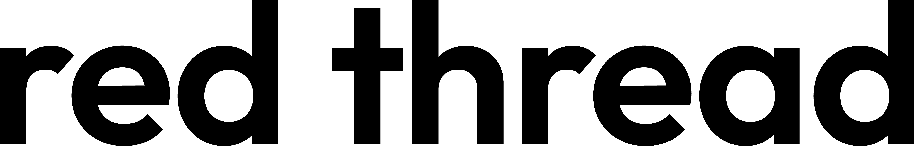

<!-- SLIDE 1: COVER -->

  

    
    
  

  <h1 class="text-5xl font-bold tracking-tight mb-4">Creator-powered commercial impact.</h1>
  
Global creator marketing born in creator culture.

---

<!-- SLIDE 2: THE PROBLEM / STATS BENTO -->

  <h2 class="text-2xl font-semibold mb-8 text-neutral-200 leading-snug">
    78% of brands could disappear tomorrow and most consumers wouldn't care.
  </h2>
  
  

    

      
46%

      
Of Gen Z skip Google, turning to social platforms for discovery.

    

    

      
92%

      
Of consumers prefer peer-to-peer recommendations over traditional ads.

    

    

      
4.7x

      
Higher returns: Creator-led content outperforms traditional advertising.

    

  

---

<!-- SLIDE 3: ATTENTION ENGINE -->

  Proprietary Tech
  <h2 class="text-3xl font-bold mb-3">Culture in motion. Powered by Attention Engine™.</h2>
  

    Built in-house to eliminate creative guesswork by forecasting cultural cut-through and predicting campaign impact before production starts.
  

  

    

      
01. Seen

      
Capturing raw awareness where audiences spend their lives.

    

    

      
02. Considered

      
Nurturing high-intent consideration through creator trust.

    

    

      
03. Chosen

      
Converting social attention into direct revenue and commercial impact.

    

  

